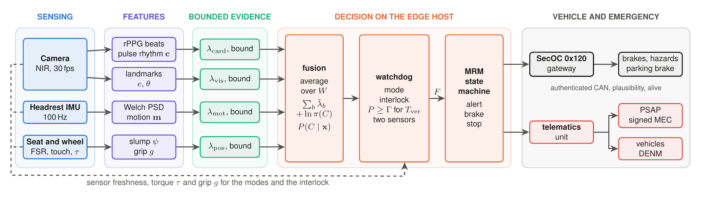

# 2. Proposed System Architecture

Three physical sensors, one edge host, one authenticated command to the
vehicle.

The diagram is Fig. 1 of the paper in colour: the same blocks, signals and arrows, drawn by `figures/architecture.tex`
(`pdflatex architecture.tex`, then `pdftoppm -png -r 220 -singlefile architecture.pdf architecture`).

## Layers

| Layer | Components | Role |
|---|---|---|
| Sensing | 30 fps camera with 850 nm illumination on the steering column | pulse beat times (rPPG), eye aspect ratio, head pitch |
| | MPU6050 accelerometer in the headrest, 100 Hz | seizure motion |
| | force-sensing resistors in the seatback and wheel rim, two capacitive touch pads, steering torque | slump, grip, driver input |
| Node | ESP32 | streams seat, wheel and IMU data in 24-byte frames with sequence number and CRC |
| Edge host | Python package `cabinguard` | features, evidence branches, fusion, watchdog, MRM state machine; inputs older than 300 ms count as missing |
| Vehicle | gateway that owns the actuators | accepts only the authenticated `0x120` command, checks plausibility, supervises the alive signal |
| Telematics | eCall unit, V2X | signed and encrypted medical message to the emergency centre; DENM to nearby vehicles without the diagnosis |

## CAN messages

Defined bit for bit in `cabinguard_mrm.dbc` (in the prototype folder) and
`cabinguard/can_messages.py`, and tested to agree:

| ID | Name | Period | Content |
|---|---|---|---|
| `0x120` | MRM_Cmd | 100 ms | phase, braking request, hazards, parking brake, door unlock, etiology, degraded level, eCall and DENM requests, shoulder request; SecOC freshness and 24-bit MAC |
| `0x121` | Health | 100 ms | sensor OK flags, degraded level, deadline overruns, posterior entropy; SecOC protected |
| `0x122` | Telematics_Status | 1 s | DENM cause codes, emergency-message state and bearer; no biometric value |

## Minimum-risk manoeuvre

Alert with chime and haptic pulse (3 s, the driver can cancel), escalation with
hazards and the emergency call, braking at 3.2 m/s² with a move to the hard
shoulder from 10 s after the alert, then parking brake and door unlock at
standstill. The phase sequence follows the transition demand of UN Regulation
No. 157, with design values of our own.

## Files

| File | What it is |
|---|---|
| `System_Architecture_and_Hardware_Spec.md` | full architecture and hardware specification |
| `hardware/README.md` | Phase 2 bench: bill of materials, wiring, bring-up, validation plan |
| `hardware/esp32_sensor_node/esp32_sensor_node.ino` | ESP32 sensor-node firmware |
| `figures/architecture.tex`, `.pdf`, `.png` | the architecture diagram above |
| `figures/*.svg` | early concept diagrams (CAN/V2X frame structure, wiring, software pipeline); the architecture diagram supersedes them where they differ |

Code: [`6_Proof_of_Concept_Prototype/prototype`](../6_Proof_of_Concept_Prototype/prototype)
(`cabinguard/pipeline.py` wires the layers together; `cabinguard/hardware.py`
holds the ESP32 frame parser and the camera front end).
