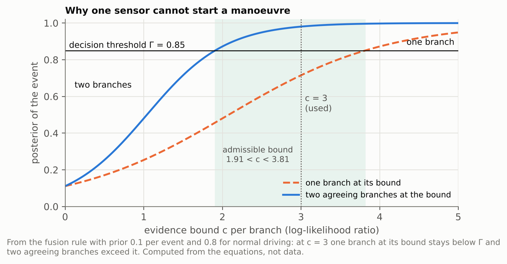
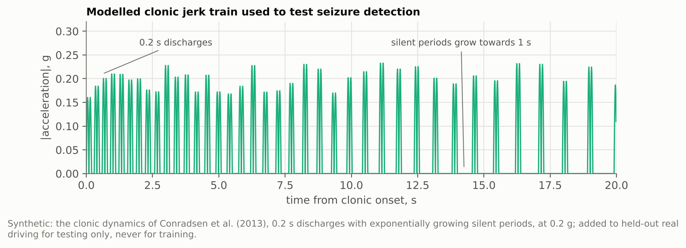

# 3. Detection & AI Methodology

Every 100 ms the system assigns the driver to one of three classes (normal
driving, cardiac syncope, convulsive seizure) and decides whether to start the
minimum-risk manoeuvre. Section V of the paper gives the equations.

## Clinical and epidemiological grounding

**Why it matters.** Sudden illness of the driver caused 1.5 % of all traffic
deaths in Finland and 3.4 % in the Swiss canton of Vaud, and probable cardiac
arrest alone about 2 % of driver deaths [1]. In a population cohort of 30,420
licensed drivers, those with epilepsy or diabetes had slightly more accidents
than unaffected drivers (standardized ratios 1.33 and 1.32) [2]. In a driving
simulator during video-EEG monitoring, every seizure with impaired
consciousness (15 of 15) or motor involvement (13 of 13) impaired driving [3].

**What each event looks like to the cabin.** The two target events have
different physiology, which is what lets the branches tell them apart:

| Event | Physiology | What the cabin sensors see | Branches that respond | Source |
|---|---|---|---|---|
| Cardiac syncope from a ventricular arrhythmia | transient loss of consciousness from cerebral hypoperfusion caused by the arrhythmia; in fibrillation, flutter or asystole no pulse reaches the face | the pulse disappears or becomes irregular; eyes close, the head drops, the hands leave the wheel, the trunk slumps | pulse rhythm, eyes and head, seat and wheel | [4] |
| | myoclonic jerks occurred in 90 % of syncopes induced in healthy volunteers | some motion even in syncope, so motion alone cannot separate the two events | (why the motion branch never decides alone) | [5] |
| Convulsive seizure | a tonic phase of sustained contraction, then clonic jerking; clonic discharges last about 0.2 s with silent periods that grow between them | rhythmic 2–6 Hz headrest motion, a clenched grip, steering-torque spikes | headrest motion, seat and wheel | [6], [7] |
| | heart rate rises during most seizures (significant ictal heart-rate change in 82 % of patients and 71 % of partial-onset seizures) | pulse present and fast, unlike syncope | pulse rhythm | [8] |

**Limits of the grounding.** The trained branches learn from public clinical
recordings (PhysioNet arrhythmia and seizure ECG, SeizeIT2 neck accelerometry
from patients in hospital), not from drivers; no clinician has reviewed the
thresholds; and the eye, head and seat likelihoods are set from the
physiology above until Phase 2 measures them.

## Features

| Channel | Features | Code |
|---|---|---|
| Pulse rhythm (camera rPPG; ECG R-peaks in the training data) | rate from the median inter-beat interval, difference from the driver's running baseline, coefficient of variation, fraction of the 10 s window without a beat | `cabinguard/cardiac_features.py`, `cabinguard/vision.py` (POS rPPG) |
| Eyes and head (camera) | eye aspect ratio from six eyelid landmarks, head pitch | `cabinguard/vision.py`, `cabinguard/hardware.py` (MediaPipe FaceLandmarker) |
| Headrest motion (IMU) | 2–6 Hz spectral energy ratio from Welch spectra, band RMS, peak frequency, total RMS, rhythmicity, peakiness | `cabinguard/motion_features.py` |
| Seat and wheel | postural slump from seatback pressure, grip state (active, disengaged, clenched), steering torque | `cabinguard/feature_extraction.py` |

## Evidence branches

| Branch | Model | Trained on | Model file |
|---|---|---|---|
| Cardiac | multinomial logistic regression, class-balanced | PhysioNet: driving study (drivedb), partial-epilepsy seizures (szdb), ventricular arrhythmia (vfdb, cudb, mitdb); validated leaving one record out | `models/cardiac_branch.joblib` |
| Motion | gradient-boosted trees with histogram splits (scikit-learn), class- and source-balanced | recorded motion only: SeizeIT2 clinical motor seizures (neck accelerometer), UEA Epilepsy seizure mimics, against patient background, PhysioNet walk-climb-drive and UCI MHEALTH; people held out in five folds; UCI HAR never trained on | `models/motion_branch.joblib` |
| Vision | expert-set Gaussian class densities on eye opening and head pitch | none: no public recording of incapacitated drivers | `cabinguard/fusion.py` |
| Posture | expert-set densities on slump and grip | none, as above | `cabinguard/fusion.py` |

`models/face_landmarker.task` is Google's pretrained MediaPipe face model; it
is not trained here. The other `.joblib` files in `models/` are comparison
models from earlier experiments and are not used by the detector.

## Bounded-evidence fusion and decision

- Each branch's posterior becomes a log-likelihood ratio against normal driving
  by dividing out its training prior.
- Each branch's evidence for an event is bounded to c = 3, so one branch can
  never reach the decision threshold Γ = 0.85 on its own and two agreeing
  branches can (the bound follows from Γ and the prior; it holds for
  1.91 < c < 3.81).
- Branches are combined with the product rule, averaged over W = 2 s; W was
  chosen out of fold (every fold chose 2 s).
- The manoeuvre starts when one event class stays above Γ for 2 s and at least
  two physical sensors agree. The camera feeds two branches but counts as one
  sensor, so a blinded lens cannot decide alone.
- Losing a sensor removes its branches (degraded modes 1 and 2); with fewer
  than two sensors no manoeuvre may start (degraded mode 3). A camera that
  contradicts an upright, steering driver is distrusted for 10 s.

The admissible band in the figure is where one branch at its bound stays below Γ while two agreeing branches exceed it; c = 3 sits inside it.

No public recording measures seizure motion at a vehicle seat, so seizure tests also use this modelled jerk train (synthetic), added to held-out real driving at 0.1, 0.2 and 0.5 g; it is never used for training.

*Figures in this folder are drawn by `6_Proof_of_Concept_Prototype/prototype/experiments/deliverable_figures.py` from the committed results and the paper's equations.*

## Beyond two etiologies: hypoglycemia and stroke

The challenge names severe hypoglycemia and acute stroke as further causes of
incapacitation. Neither is detected by this prototype, but both fit the same
framework, and the evidence below shows which in-cabin signals carry them:

| Event | What changes at the wheel | In-cabin evidence reported in the literature | Sensors already in CabinGuard | What would be added | Source |
|---|---|---|---|---|---|
| Severe hypoglycemia | driving is disrupted already at mild hypoglycemia, and drivers hesitate to take corrective action | in 30 people with type 1 diabetes driving a real car on a test track, hypoglycemia was detected with an AUROC of 0.80 from both data types, 0.73 from driving data alone and 0.70 from gaze and head motion alone | camera (gaze, head pose), steering torque | a hypoglycemia branch on gaze, head and steering features, plus vehicle signals such as lane position | [9], [10] |
| Acute stroke | sudden weakness of one side | the Cincinnati Prehospital Stroke Scale scores facial droop, arm drift and abnormal speech; an abnormal item identified stroke with 66 % sensitivity and 87 % specificity in hospital patients | camera landmarks (facial symmetry), left and right rim touch pads (one-sided grip) | an asymmetry branch on facial landmarks and left-right grip | [11] |

**How a new class enters.** Each event class adds one column to the branch
evidence; the same bound applies to every branch, so one sensor still cannot
start a manoeuvre, and the two-sensor rule is unchanged. The interfaces already
have room: the etiology field of `0x120` is 3 bits with codes 3 to 6 unused,
and the medical message has an "unspecified" etiology code (0xFF). The V2X
warning does not change, because it never carries the diagnosis. No data or
result for these two events is claimed here; they are Phase 2 work.

Code: `cabinguard/fusion.py` (branches and fusion), `cabinguard/watchdog.py`
(decision rule, degraded modes, spoofing interlock), `cabinguard/config.py`
(thresholds), all under
[`6_Proof_of_Concept_Prototype/prototype`](../6_Proof_of_Concept_Prototype/prototype).

Training scripts: `experiments/realdata/train_branches.py` (cardiac) and
`experiments/realdata/train_motion_real.py` (motion); results and how to
reproduce them are in [`5_Validation_Benchmarking`](../5_Validation_Benchmarking).

## Sources

1. M. O. Halinen and A. Jaussi, "Fatal road accidents caused by sudden death of the driver in Finland and Vaud, Switzerland," *Eur. Heart J.*, vol. 15, no. 7, pp. 888–894, 1994, doi: 10.1093/oxfordjournals.eurheartj.a060606.
2. B. Hansotia and S. K. Broste, "The effect of epilepsy or diabetes mellitus on the risk of automobile accidents," *N. Engl. J. Med.*, vol. 324, no. 1, pp. 22–26, 1991.
3. A. Kumar *et al.*, "Simulated driving in the epilepsy monitoring unit: Effects of seizure type, consciousness, and motor impairment," *Epilepsia*, vol. 63, no. 1, pp. e30–e34, 2022, doi: 10.1111/epi.17136.
4. W.-K. Shen *et al.*, "2017 ACC/AHA/HRS guideline for the evaluation and management of patients with syncope," *Circulation*, vol. 136, no. 5, pp. e25–e59, 2017.
5. T. Lempert, M. Bauer, and D. Schmidt, "Syncope: A videometric analysis of 56 episodes of transient cerebral hypoxia," *Ann. Neurol.*, vol. 36, no. 2, pp. 233–237, 1994.
6. R. S. Fisher *et al.*, "Operational classification of seizure types by the International League Against Epilepsy," *Epilepsia*, vol. 58, no. 4, pp. 522–530, 2017.
7. I. Conradsen, M. Moldovan, P. Jennum, P. Wolf, D. Farina, and S. Beniczky, "Dynamics of muscle activation during tonic-clonic seizures," *Epilepsy Res.*, vol. 104, no. 1–2, pp. 84–93, 2013.
8. K. S. Eggleston, B. D. Olin, and R. S. Fisher, "Ictal tachycardia: The head–heart connection," *Seizure*, vol. 23, no. 7, pp. 496–505, 2014.
9. D. J. Cox, L. A. Gonder-Frederick, B. P. Kovatchev, D. M. Julian, and W. L. Clarke, "Progressive hypoglycemia's impact on driving simulation performance," *Diabetes Care*, vol. 23, no. 2, pp. 163–170, 2000, doi: 10.2337/diacare.23.2.163.
10. V. Lehmann *et al.*, "Machine learning to infer a health state using biomedical signals: Detection of hypoglycemia in people with diabetes while driving real cars," *NEJM AI*, 2024, doi: 10.1056/AIoa2300013.
11. R. U. Kothari, A. Pancioli, T. Liu, T. Brott, and J. Broderick, "Cincinnati Prehospital Stroke Scale: Reproducibility and validity," *Ann. Emerg. Med.*, vol. 33, no. 4, pp. 373–378, 1999.
