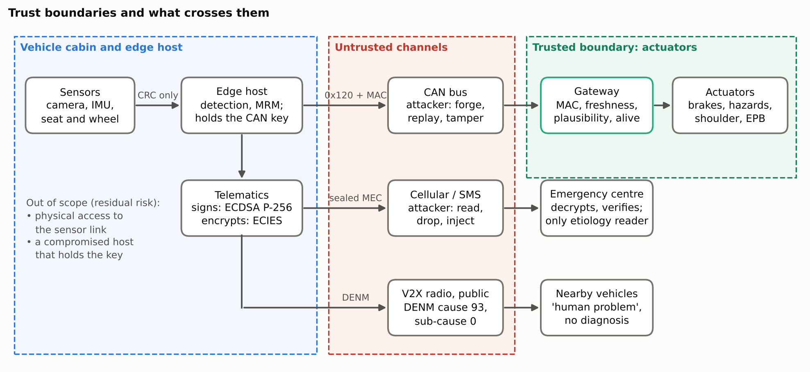
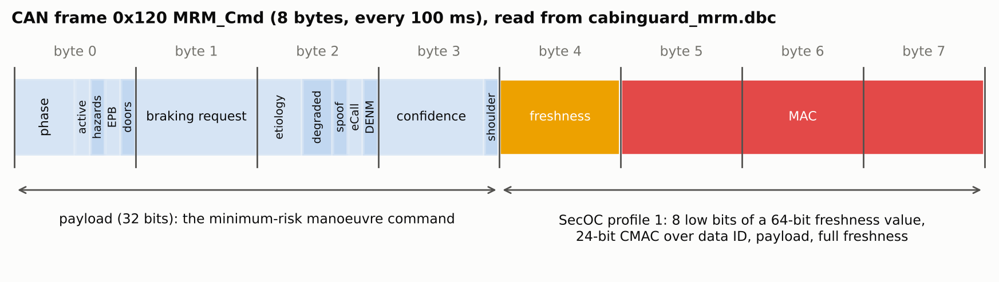

# 4. Security & Threat Model

The gateway in front of the actuators is the trusted boundary. The CAN bus,
the cellular network and the radio channel are untrusted.
`Cybersecurity_and_Threat_Model_Dossier.md` is the full dossier: assets and
trust boundaries, STRIDE threats and controls, the `0x120` frame, the emergency
message, and privacy engineering.

## Threats, controls and the test that exercises each

| Threat | Control | Test |
|---|---|---|
| Forged command | 24-bit AES-128-CMAC, AUTOSAR SecOC profile 1 | fault matrix: unauthorized key |
| Replayed command | 64-bit freshness value, low 8 bits sent | fault matrix: replayed frames |
| Tampered frame | MAC check, alive timeout | fault matrix: tampered frames |
| Valid MAC, unsafe value | phase-order plausibility, braking limited to 0 to −4 m/s² | fault matrix: implausible command |
| Camera blinding or spoofing | cross-sensor interlock, two-sensor rule | fault matrix: optical blinding |
| Lost or stale sensor | freshness check, degraded modes | fault matrix: IMU disconnect, seat stale |
| Host hang | fail-silent host; gateway completes a manoeuvre already under way | fault matrix: two processing cases |
| Network outage | retries, SMS fallback, queue | fault matrix: two bearer cases |
| Forged or read emergency message | ECDSA P-256 signature from a pseudonymous key, ECIES encryption to the emergency centre | unit tests |

All 140 fault-matrix runs (14 cases, 10 seeds, synthetic sensors) reached the
required outcome; see [`5_Validation_Benchmarking`](../5_Validation_Benchmarking).

The layout is read from `cabinguard_mrm.dbc`; the payload, the database file and the decoder are tested to agree bit for bit.

*Figures in this folder are drawn by `6_Proof_of_Concept_Prototype/prototype/experiments/deliverable_figures.py` from the committed results and the paper's equations.*

## Privacy

- The 76-byte medical extension container (MEC) carries the etiology,
  confidence, latency, heart rate and a sequence number, signed and then
  encrypted (137 bytes sealed). It travels beside the eCall, whose minimum set
  of data already has the location; no identity, video or waveform.
- Nearby vehicles receive a DENM with cause 93 (human problem) and sub-cause 0
  (unavailable): the diagnosis never leaves the emergency channel.
- The status frame `0x121` that other nodes can read carries sensor health
  only, never a biometric value. Only 10 s feature buffers exist, in memory.

## Residual risks (out of scope, stated in the paper)

- An attacker with physical access to the in-cabin sensor link: the link has a
  CRC against corruption, not authentication.
- A compromised host that holds the CAN key: it passes both gateway checks, and
  since the gateway checks the order of the phases but not their duration, it
  could brake at −4 m/s² within three frames. Phase 2 options are minimum phase
  durations, a gateway-side brake-pedal cancel and a tighter braking cap.
- The demo key is public and kept in software; a deployment needs a hardware
  security module.

## Code

Under [`6_Proof_of_Concept_Prototype/prototype`](../6_Proof_of_Concept_Prototype/prototype):
`cabinguard/secoc.py` (SecOC sender and receiver), `cabinguard/can_messages.py`
and `cabinguard_mrm.dbc` (frames), `cabinguard/crypto.py` (AES-128-CMAC with the
RFC 4493 self-test), `cabinguard/vehicle_gateway.py` (plausibility gate, alive
supervision), `cabinguard/emergency_link.py` (MEC, ECDSA, ECIES, bearer
failover). Tests:
`tests/test_security_comm.py`, `tests/test_shoulder_gateway.py`.
