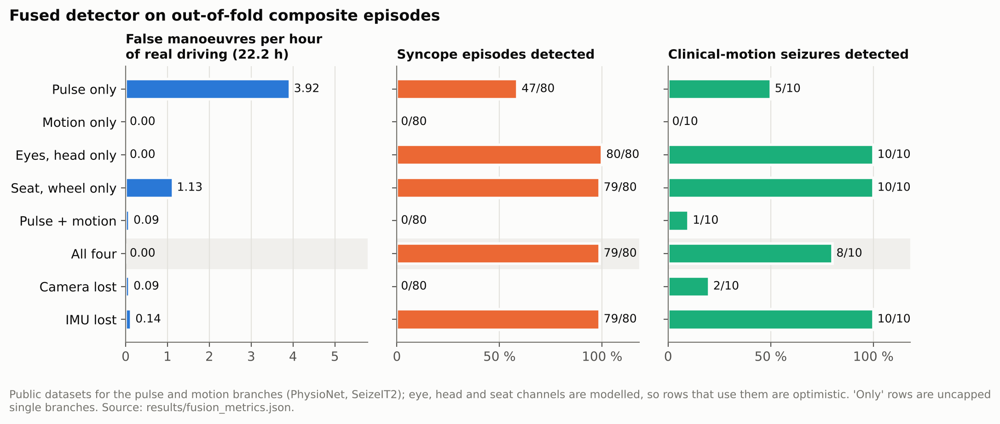
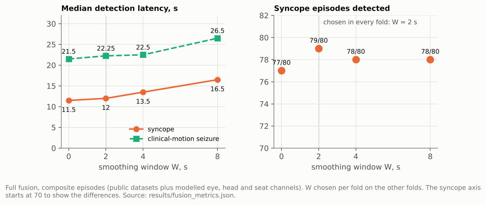
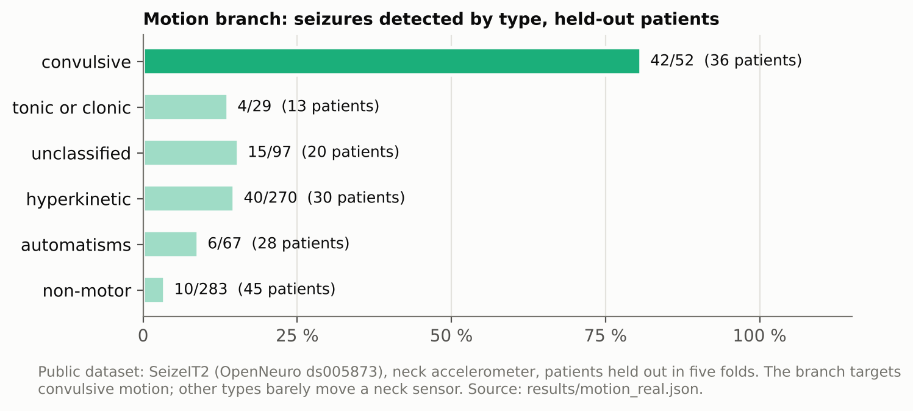
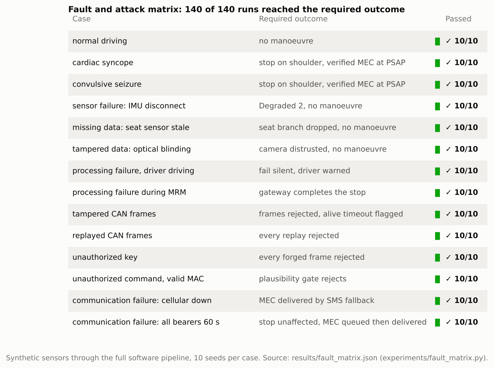

# 5. Preliminary Validation / Benchmarking

Each result names its evidence class. Public-dataset results come from models
that never saw the record, subject or patient they are scored on. Synthetic
results exercise the software; they are not detection performance.

## Results

| What | Result | Evidence class | File |
|---|---|---|---|
| Cardiac branch (logistic regression), 130 records, leave one record out | AUC 0.955 for ventricular arrhythmia, 0.846 for seizure | public datasets: PhysioNet drivedb, szdb, vfdb, cudb, mitdb | `results/branch_metrics.json` |
| Motion branch, patients held out | 42 of 52 convulsive seizures detected (36 patients); alone 9.7 alarms per hour of driving at the hip, 6.8 at the wrist | public datasets: SeizeIT2, UEA Epilepsy, PhysioNet walk-climb-drive, UCI MHEALTH | `results/motion_real.json` |
| Fused detector, all four branches | 0 false manoeuvres in 22.2 h of real driving (95 % upper bound 0.14 per hour); syncope 79/80, clinical-motion seizure 8/10; median latency 12.0 s and 22.2 s | composite episodes: real cardiac and motion branches, modelled eye, head and seat channels (so optimistic) | `results/fusion_metrics.json` |
| Cardiac branch alone, uncapped | 3.92 false starts per hour, syncope 47/80 | as above | `results/fusion_metrics.json` |
| Camera lost / IMU lost | syncope 0/80 by design / clinical seizure 10/10 | as above | `results/fusion_metrics.json` |
| Smoothing window W | chosen per fold on the other folds; all five folds chose 2 s, so the held-out results equal the table above | as above | `results/fusion_metrics.json` (`w_selection`) |
| Fault and attack matrix | 140 of 140 runs reached the required outcome (14 cases, 10 seeds) | synthetic sensors through the full software pipeline | `results/fault_matrix.json` |
| Cycle time | median 5.8 ms, 99th percentile 11.0 ms, worst 81 ms, against a 100 ms deadline | synthetic run; the current file predates the host record, so re-run it on the target PC | `results/fault_matrix.json` |
| Closed-loop Simulink tests (one highway scene, 100 km/h) | 5 tests: alert, hazards with eCall and take-over at onset + 12, 16 and 22 s; controlled stop in 8.8 s; no take-over with a conscious driver; camera lost +0.6 s; eCall by SMS when cellular is down | synthetic simulation, surrogate detector, scripted traffic | `matlab_simulation/results_final/suite_github/suite_system.csv` |

All files are under `6_Proof_of_Concept_Prototype/prototype/`. The paper
quotes these numbers through `1_IEEE_Research_Paper/paper_numbers.tex`, which
is generated from the same files.



Single branches either raise false starts (pulse alone, 3.92 per hour) or miss one event class; all four branches together start no manoeuvre in 22.2 h of real driving and detect both events. Rows that use the eye, head or seat channels are optimistic, since those channels are modelled.





The motion branch finds convulsive seizures and few others, which a neck sensor barely registers; that is why it votes together with the camera and the seat rather than alone.



*Figures in this folder are drawn by `6_Proof_of_Concept_Prototype/prototype/experiments/deliverable_figures.py` from the committed results and the paper's equations.*

## Reproduce

Heavy jobs run on your own PC or in the Colab notebook
(`experiments/colab/CabinGuard_Colab.ipynb`). Datasets download into `data/` at
the repository root, which git ignores.

```
cd 6_Proof_of_Concept_Prototype/prototype
python -m cabinguard.physionet_fetch drivedb szdb vfdb cudb mitdb accelerometry-walk-climb-drive
python experiments/realdata/extract_cardiac.py --workers 8
python experiments/realdata/extract_motion.py --workers 8
python experiments/realdata/extract_motion.py --branch --workers 8
python experiments/realdata/extract_seizeit2.py --workers 16     # SeizeIT2 seizure minutes (OpenNeuro), ~30 min
python experiments/realdata/train_branches.py                    # cardiac branch
python experiments/realdata/train_motion_real.py                 # motion branch; downloads UEA Epilepsy, MHEALTH, HAR
python experiments/realdata/evaluate_fusion.py                   # fused detector, nested choice of W
python experiments/fault_matrix.py --seeds 10                    # synthetic, ~5 min
python experiments/export_paper_numbers.py                       # refresh the paper's numbers
python run_jury_demo.py --record && python experiments/demo_timing.py   # cycle time on this machine, with the dashboard
```

## Datasets

PhysioNet (Goldberger et al., Circulation 2000): Stress Recognition in
Automobile Drivers (drivedb), Post-Ictal Heart Rate Oscillations in Partial
Epilepsy (szdb), MIT-BIH Malignant Ventricular Ectopy (vfdb), CU Ventricular
Tachyarrhythmia (cudb), MIT-BIH Arrhythmia (mitdb), and Labeled raw
accelerometry data captured during walking, stair climbing and driving.
SeizeIT2 (OpenNeuro ds005873, CC0), UEA Epilepsy (timeseriesclassification.com),
UCI MHEALTH and UCI HAR (CC BY 4.0). Each keeps its own licence; none is
redistributed here.

## MATLAB/Simulink vehicle simulation

[`matlab_simulation`](matlab_simulation) holds a closed-loop Simulink model:
the CabinGuard decision and gateway logic driving a vehicle in a driving
scenario with radar and camera perception. It checks the response logic in
traffic; its detector is a stand-in, so it says nothing about detection
performance.
