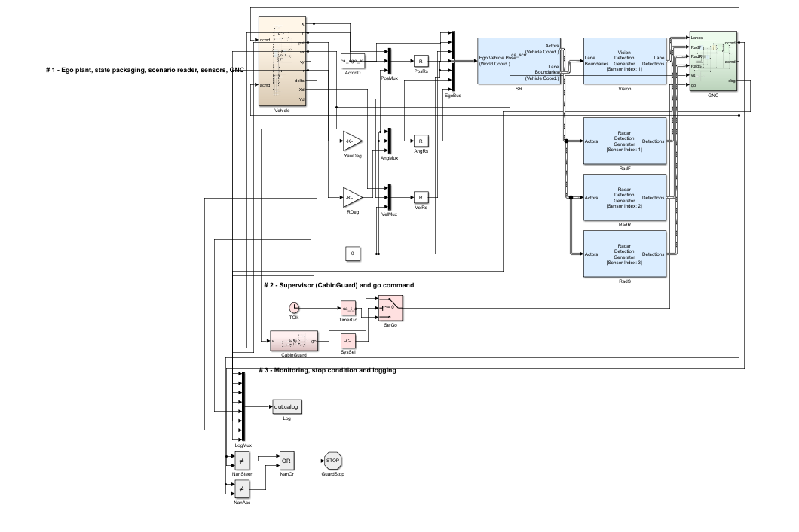
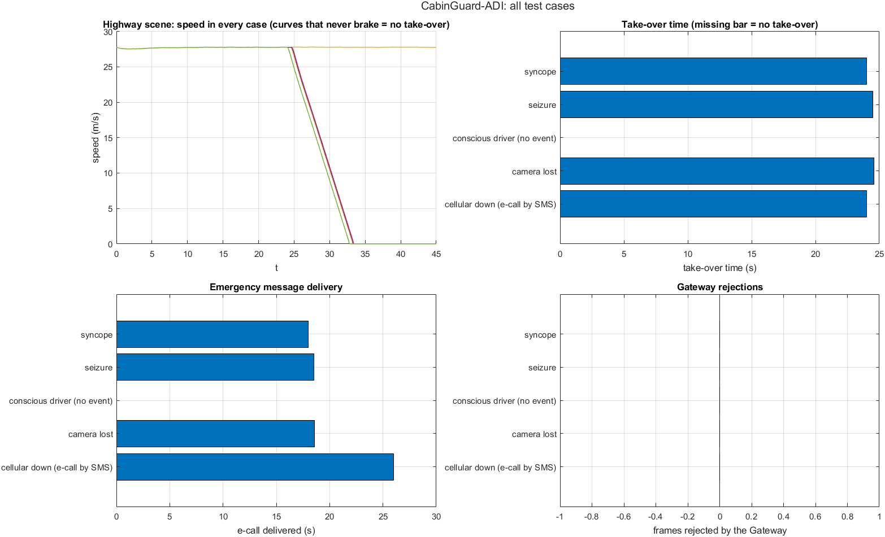
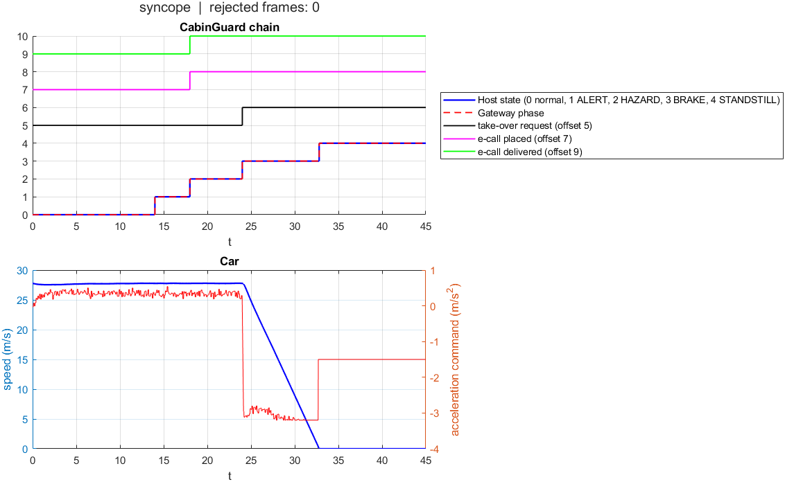

# Closed-loop MATLAB/Simulink simulation

The CabinGuard take-over chain in closed loop with a vehicle that drives a
Driving Scenario Designer road, with radar and camera perception of other road
users. It asks whether the minimum-risk manoeuvre behaves as designed in
traffic. It does not measure detection: the AI is replaced by a surrogate
detector with a fixed delay.

Evidence class: **synthetic simulation**. Other cars and pedestrians follow
fixed scripts and do not react to the ego vehicle.

`MANUAL_SIMULATION.md` is the full user manual; `RESULTS_github_profile.md`
gives the closed-loop results with the Python system's timings.

## Run it

Requirements: MATLAB with Simulink, Automated Driving Toolbox (driving
scenario, Scenario Reader, radar and vision detection generators), Model
Predictive Control Toolbox (Lane Keeping Assist System block), Vehicle Dynamics
Blockset (wheel and disc-brake blocks of the detailed plant). No GPU, hardware
or internet.

```matlab
cd 5_Validation_Benchmarking/matlab_simulation
bdclose all; clear all; clc
cg_auto_build                 % builds CabinGuardAuto.slx from the scripts
cg_sys_unittest               % 28 checks of the chain without Simulink: expect "28 passed, 0 FAILED"
cg_auto_suite('quick')        % 6 closed-loop runs; figures, csv and txt go to results/
cg_final_run('fast')          % the scenarios used for the write-up, collected in results_final/
```

`CabinGuard_MATLAB_simulation.slx` is a built copy of the model (MATLAB
R2024a), kept so the block diagram can be opened without running the build;
`cg_auto_build` regenerates the same model as `CabinGuardAuto.slx`. Opened
directly, the model needs the workspace variables (`ca_*`) that `cg_auto_run`
sets, so start from the scripts.

## What is simulated



The top level of the model has three areas:

1. **Ego plant, state packaging, scenario reader, sensors, GNC:** the vehicle
   plant (`Vehicle`) feeds its pose to the Scenario Reader (`SR`), which drives
   the vision lane detector and three radar detection generators (front, rear,
   right side); guidance, navigation and control (`GNC`) turns their detections
   into the steering and acceleration commands.
2. **Supervisor (CabinGuard) and go command:** the `CabinGuard` subsystem (the
   chain in the `cg_sys_*` scripts) decides when the car takes over; `SysSel`
   switches between that decision and a fixed timer (`TimerGo`).
3. **Monitoring, stop condition and logging:** signals are logged to `calog`,
   and the run stops if a steering or acceleration command becomes NaN.


Driver incapacitated (syncope or seizure) → surrogate detector → fault
injection → host (bounded-evidence fusion, 2 s verification, two-sensor rule,
camera interlock, MRM state machine) → gateway (authenticated commands, 300 ms
alive timeout, deceleration limited to −4 to 0 m/s², phase order, jerk limit) →
take-over → perception, decision, guidance and control from Simulink blocks →
detailed longitudinal plant and bicycle lateral model. Telemetry: eCall by
cellular with retries, then SMS.

| Script group | Role |
|---|---|
| `cg_sys_*.m` | the CabinGuard chain: `cg_sys_detector` (surrogate), `cg_sys_driver`, `cg_sys_faults`, `cg_sys_host`, `cg_sys_gateway`, `cg_sys_telem`; `cg_sys_unittest` checks them without Simulink |
| `cg_auto_*.m` | the closed-loop vehicle model: build, plant, scenes, options, single runs, batches, evaluation |
| `cg_final_run.m` | the scenarios used for the write-up |
| `cg_dsd_*.m` | an earlier Driving Scenario Designer model with a behaviour-cloning controller, kept for comparison |

With `profile = 'github'` the timings follow the Python system: alert 12 s
after onset (the median latency of `fusion_metrics.json`, not a result of this
model), hazards 4 s later, braking at −3.2 m/s² 10 s after the alert, 100 km/h.

## Closed-loop test results

Five tests run in the full Simulink model with the detailed plant
(`cg_auto_suite('github')`): highway scene 1, 100 km/h, 45 s, incapacitation
at 2 s, and the Python system's timings. [`TESTS.md`](TESTS.md) describes each
test and what it proves; the raw numbers, one chain figure and one vehicle
figure per test, and the overview are in
[`results_final/suite_github/`](results_final/suite_github).



| # | Test | Injected | Alert | Hazards and eCall | Take-over | eCall delivered | Outcome |
|---|---|---|---|---|---|---|---|
| 1 | Syncope | syncope at 2 s | 14.0 s | 18.0 s | 24.0 s | 18.0 s | stopped in 8.8 s over 123 m; rear-end touch by the scripted follower at 30.5 s, 0.7 m/s |
| 2 | Seizure | seizure at 2 s | 14.5 s | 18.5 s | 24.5 s | 18.5 s | stopped in 8.8 s over 123 m, no collision (smallest gap 0.11 m) |
| 3 | Conscious driver | nothing | none | none | none | none | no alert and no take-over, as required |
| 4 | Camera lost | camera fails at 2 s | 14.6 s | 18.6 s | 24.6 s | 18.6 s | degraded mode, +0.6 s, stopped, no collision |
| 5 | Cellular down | cellular unavailable | 14.0 s | 18.0 s | 24.0 s | 26.0 s by SMS | stop unchanged; same follower touch as test 1 |

Source: [`results_final/suite_github/suite_system.csv`](results_final/suite_github/suite_system.csv).
The gateway rejected no frame in any test (no attack was injected here; the
attack cases are in the Python fault matrix).

**What the tests show.** The chain runs end to end in closed loop: the
detector output is verified by the host, the alert, hazards and emergency call
follow on the designed timeline (alert at onset + 12 s, hazards + 4 s,
take-over + 10 s), the gateway accepts the braking command, and the car stops
under control at −3.2 m/s². A conscious driver triggers nothing, a lost camera
costs 0.6 s, and a cellular outage moves the emergency call to SMS without
delaying the stop.



**The two collision flags.** Tests 1 and 5 are flagged only because the
scripted car behind, which does not react to the ego car, touches it at
0.7 m/s after the take-over; at the take-over only 0.3 m/s² of braking was
needed for anything ahead. In test 1 the right side was flagged as occupied,
so the car braked in its lane rather than moving to the shoulder. The contact
is reported, not tuned away. Test 3's contact with a slow car ahead at 33.6 s
happens with no take-over, because the simulated conscious driver does not
brake for traffic; the scene is marked invalid and not counted.

**What follows from it.** With these timings the car keeps its speed without
driver control for about 22 s (about 600 m at 100 km/h) before braking begins,
and the model has no emergency braking of its own in that interval. Phase 2
adds the real detector in the loop, reactive traffic, protection of that
interval (emergency braking and a follower warning) and more scenes. One scene
per test: the results are indications, not statistics.

## Limits

The detector is a surrogate; the latency is taken from the Python evaluation.
Authentication is a pass/fail flag: SecOC, ECDSA and ECIES are implemented and
tested only in the Python prototype. Other traffic follows scripts. The two
implementations of the chain (MATLAB and Python) are kept in step by hand.
