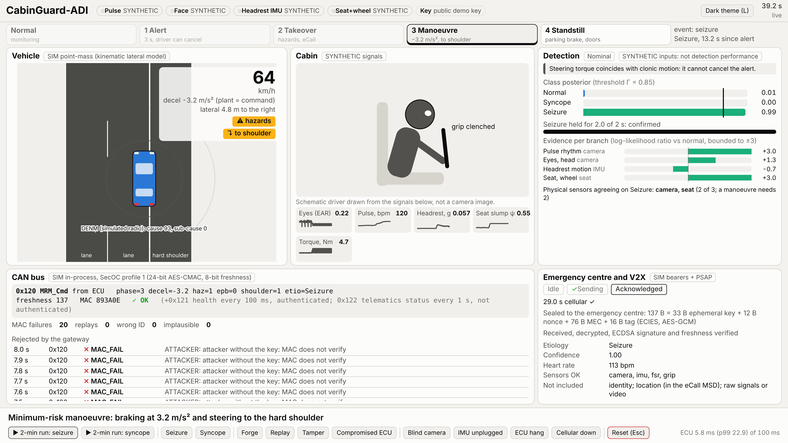

# 6. Proof-of-Concept Prototype

A Python package that implements the whole chain, from sensor frames to
authenticated CAN commands and the emergency message, plus a live dashboard
that runs the same code for the jury.

**Demo video:** [`media/cabinguard_demo.mp4`](media/cabinguard_demo.mp4) (64 s): the scripted syncope run on synthetic signals, from cruising at 100 km/h through the forged-frame attack, the alert, the eCall and the manoeuvre to the stop on the hard shoulder.



*The dashboard during the scripted seizure run, on synthetic signals (every
panel says where its data comes from): the vehicle braking and moving to the
hard shoulder, the cabin signals, the detection evidence, the CAN frames with
the gateway's verdicts (including forged frames rejected), and the sealed
emergency message received at the emergency centre. Regenerate it with
`python prototype/experiments/dashboard_figure.py`.*

## Layout

```
prototype/
  cabinguard/            package: features, fusion, watchdog, MRM controller,
                         SecOC CAN, gateway, eCall/MEC, simulator, hardware front ends
  cabinguard/demo/       jury dashboard: engine, runner, web server, static page
  experiments/realdata/  dataset extraction, branch training, fused evaluation
  experiments/           fault matrix, paper numbers, demo timing, dashboard figure
  experiments/colab/     Colab notebook and auxiliary dataset scripts
  models/                trained branch models and the MediaPipe face model
  results/               every number quoted in the paper
  tests/                 pytest suite
  run_demo.py            scenarios through the full pipeline
  run_realtime.py        10 Hz real-time ECU loop (simulated or hardware sensors, CAN)
  run_gateway.py         actuator-side gateway for the CAN bench
  run_jury_demo.py       the jury dashboard
  carla_bridge.py        CARLA co-simulation bridge, for Phase 2
  cabinguard_mrm.dbc     CAN database, bit-exact with cabinguard/can_messages.py
```

## Quick start

Python 3.11 or newer, from the repository root:

```
pip install -e "6_Proof_of_Concept_Prototype/prototype[dev,demo]"   # add ,hardware for the webcam and the ESP32
cd 6_Proof_of_Concept_Prototype/prototype
python -m pytest -q
python run_demo.py                  # all scenarios
python run_demo.py --scenario seizure
python run_demo.py --scenario normal --attack forge
python run_realtime.py --scenario syncope --can virtual
```

## Jury dashboard

Runs the same ECU, gateway, SecOC, eCall and DENM code at 10 Hz on wall clock,
with every input switchable between the scenario simulator and live hardware.
It needs no GPU and no internet, and binds to 127.0.0.1 only.

```
python run_jury_demo.py                             # all synthetic; opens http://127.0.0.1:8765
python run_jury_demo.py --camera 0                  # live face channel from the laptop webcam
python run_jury_demo.py --camera 1 --serial COM5    # USB webcam and the ESP32 sensor node
python run_jury_demo.py --record                    # also writes every cycle to data/demo_sessions/*.jsonl
```

Keys in the browser: P plays the scripted run (forged frame at 6 s, seizure at
14 s, stop on the hard shoulder about 45 s after play), S seizure, Y syncope,
F/R/T/I CAN attacks (forge, replay, tamper, compromised ECU), B/U/H/C faults
(blinded camera, IMU unplugged, ECU hang, cellular down), Esc reset, L light or
dark theme.

Every input carries a chip the engine computes: SYNTHETIC (simulator signals,
which exercise the software and are not detection performance), LIVE (a device
now) or INJECTED (an operator fault or attack). The vehicle is a point mass
with a kinematic lateral model on an in-process bus, and the bearers and the
emergency centre are simulated; the dashboard says so on each panel. A recorded
session holds derived signals and decisions, never camera frames.

## Hardware

The ESP32 sensor-node firmware, bill of materials and wiring are in
[`2_System_Architecture/hardware`](../2_System_Architecture/hardware).
