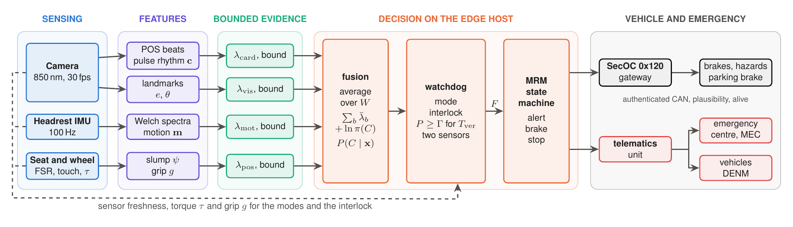
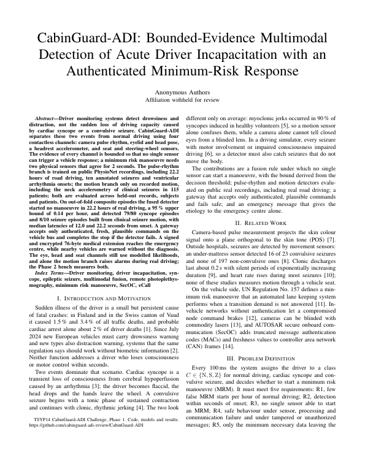
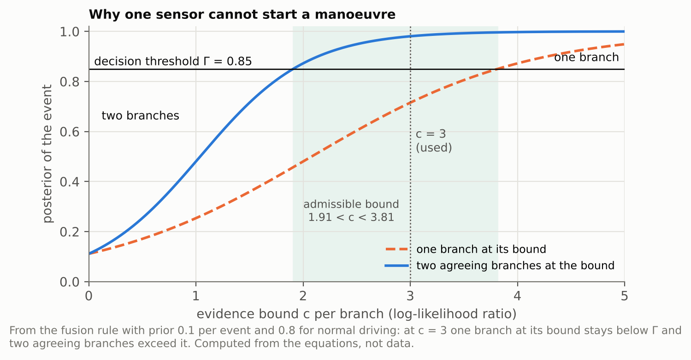
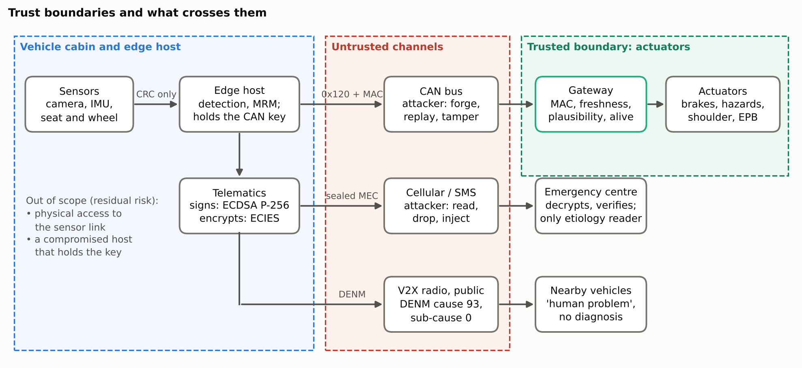
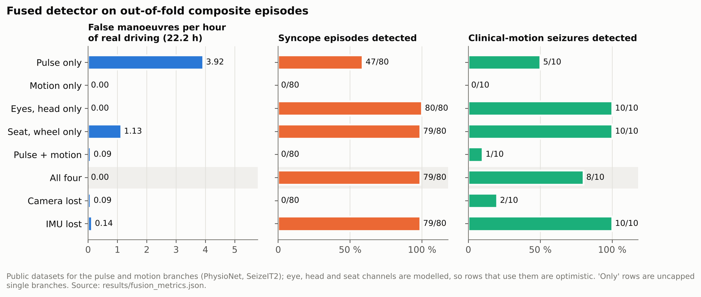
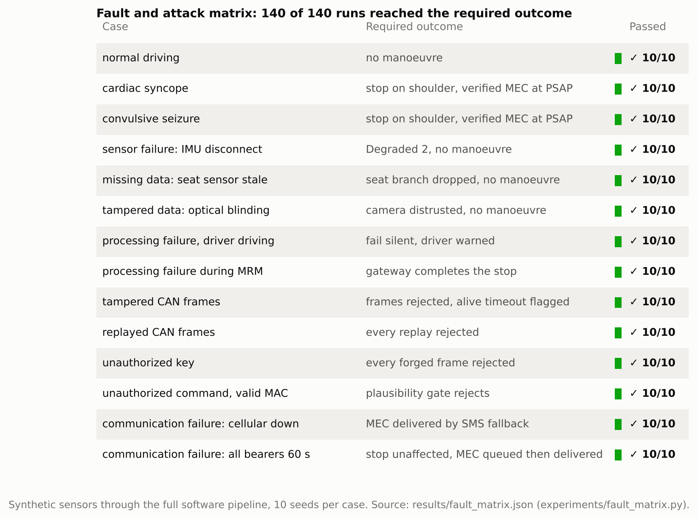
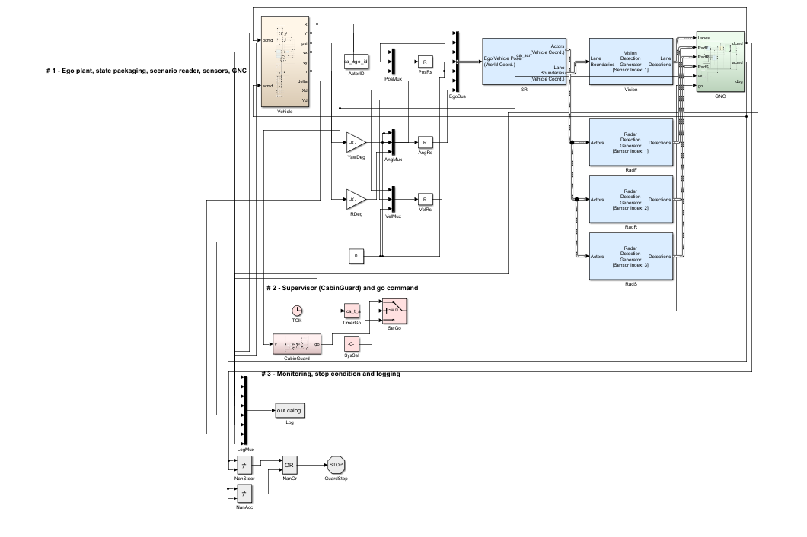

<h1 align="center">CabinGuard-ADI</h1>

<p align="center">
<b>In-cabin detection of acute driver incapacitation, connected to an authenticated minimum-risk manoeuvre and a privacy-preserving emergency call.</b><br>
Cardiac syncope and convulsive seizure versus normal driving · IEEE VTS TSYP14 CabinGuard-ADI challenge
</p>

<p align="center">

</p>

<table align="center">
<tr>
<td align="center"><h3>0 in 22.2 h</h3>false manoeuvres on real driving<br><sub>public datasets, composite episodes</sub></td>
<td align="center"><h3>79 / 80</h3>syncope episodes detected<br><sub>PhysioNet arrhythmia onsets</sub></td>
<td align="center"><h3>8 / 10</h3>seizures with clinical motion<br><sub>SeizeIT2 neck accelerometry</sub></td>
<td align="center"><h3>140 / 140</h3>fault and attack runs passed<br><sub>synthetic sensors, full pipeline</sub></td>
</tr>
</table>

<p align="center"><sub>Eye, head and seat channels are modelled in the composite episodes, so the fused numbers are an upper estimate until Phase 2 measures them. Every number names its evidence class; nothing synthetic is reported as clinical or vehicle performance.</sub></p>

<p align="center">
<a href="6_Proof_of_Concept_Prototype/media/cabinguard_demo.mp4"><b>Watch the 64-second demo</b></a> &nbsp;·&nbsp;
<a href="1_IEEE_Research_Paper/IEEE_Research_Paper_CabinGuard.pdf"><b>Read the paper</b></a> &nbsp;·&nbsp;
<a href="#quick-start"><b>Run it</b></a>
</p>

---

The repository is organised by deliverable, one folder each:

| # | Deliverable | Folder |
|---|---|---|
| 1 | IEEE-style research paper (max. 5 pages) | [`1_IEEE_Research_Paper`](1_IEEE_Research_Paper) |
| 2 | Proposed system architecture | [`2_System_Architecture`](2_System_Architecture) |
| 3 | Detection and AI methodology | [`3_Detection_AI_Methodology`](3_Detection_AI_Methodology) |
| 4 | Security and threat model | [`4_Security_Threat_Model`](4_Security_Threat_Model) |
| 5 | Preliminary validation and benchmarking | [`5_Validation_Benchmarking`](5_Validation_Benchmarking) |
| 6 | Proof-of-concept prototype | [`6_Proof_of_Concept_Prototype`](6_Proof_of_Concept_Prototype) |

The code lives once, in the prototype folder; the other folders document their
part and point to the modules, scripts and result files behind it.

## 1. IEEE-Style Research Paper



[`1_IEEE_Research_Paper`](1_IEEE_Research_Paper): the five-page Phase 1 paper
(`IEEEtran`, conference), its PDF, and the macro files that carry every number
it quotes. Those files are generated from the committed results by
`export_paper_numbers.py`; no number is typed by hand. The review copy is
anonymous.

It covers the problem and requirements, the architecture, the detection
method with its equations, safety and fault handling, the threat model, the
evaluation on public datasets, and the results.

<br clear="right">

## 2. Proposed System Architecture

[`2_System_Architecture`](2_System_Architecture): three physical sensors (an
850 nm steering-column camera, a headrest accelerometer, seat and wheel sensors
on an ESP32 node), an edge host that runs detection, the watchdog and the
minimum-risk manoeuvre (MRM) state machine, and a gateway that owns the
actuators and accepts only one authenticated CAN command (the diagram at the
top). Includes the hardware and architecture specification, the ESP32
firmware, the bill of materials and the wiring.

## 3. Detection & AI Methodology

[`3_Detection_AI_Methodology`](3_Detection_AI_Methodology): four evidence
branches (pulse rhythm, eyes and head, headrest motion, seat and wheel), a
logistic-regression cardiac model and a gradient-boosted motion model trained
on public recordings, and bounded-evidence fusion in which no single sensor can
start a manoeuvre: a manoeuvre needs two agreeing physical sensors for 2 s.

<p align="center">

</p>

## 4. Security & Threat Model

[`4_Security_Threat_Model`](4_Security_Threat_Model): assets, attackers and
controls. AUTOSAR SecOC profile 1 (24-bit AES-CMAC, freshness value) on the
command frame, a gateway plausibility gate and alive supervision, a signed
(ECDSA P-256) and encrypted (ECIES) medical message for the emergency centre
only, a V2X warning that never carries the diagnosis, and the residual risks
stated plainly.

<p align="center">

</p>

## 5. Preliminary Validation / Benchmarking

[`5_Validation_Benchmarking`](5_Validation_Benchmarking): held-out evaluation
on public datasets (PhysioNet, SeizeIT2, UEA Epilepsy, UCI MHEALTH and HAR),
fused results on composite episodes, a 14-case fault and attack matrix through
the full software pipeline, cycle timing, and a closed-loop MATLAB/Simulink
vehicle simulation. Includes the commands that reproduce every result.

<p align="center">

</p>

<p align="center">


</p>

## 6. Proof-of-Concept Prototype

[`6_Proof_of_Concept_Prototype`](6_Proof_of_Concept_Prototype): the Python
package that implements everything above, its tests, the 10 Hz real-time loop,
the CAN gateway, and a live jury dashboard that runs the same code with
synthetic, webcam or ESP32 inputs. ▶ [Demo video](6_Proof_of_Concept_Prototype/media/cabinguard_demo.mp4)
(64 s, scripted syncope run on synthetic signals).

<p align="center">

</p>

## Quick start

Python 3.11 or newer, from the repository root:

```
pip install -e "6_Proof_of_Concept_Prototype/prototype[dev,demo]"
cd 6_Proof_of_Concept_Prototype/prototype
python -m pytest -q                 # features, fusion rules, pipeline, faults, CAN, crypto, demo
python run_demo.py --scenario seizure
python run_jury_demo.py             # live dashboard on http://127.0.0.1:8765
```
