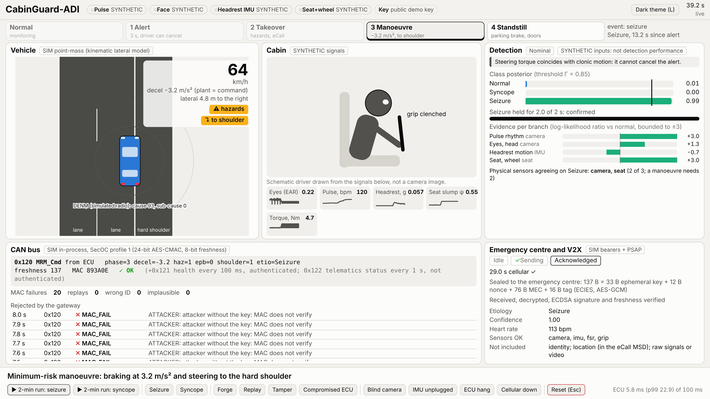

# CabinGuard-ADI

In-cabin detection of acute driver incapacitation (cardiac syncope and
convulsive seizure versus normal driving), connected to an authenticated
minimum-risk manoeuvre and a privacy-preserving emergency call. Submission for
the IEEE VTS TSYP14 CabinGuard-ADI challenge.

```
camera (eyes, head, rPPG) ─┐                                       ┌─▶ gateway ─▶ brakes, hazards, EPB, shoulder
headrest IMU ──────────────┼─▶ features ─▶ fusion ─▶ watchdog ─▶ MRM ─┤   (SecOC CAN, plausibility, alive timeout)
seat FSR, wheel grip ──────┘   (per sensor)  (bounded)  (modes,      └─▶ eCall: signed, encrypted 76-byte MEC
                                              evidence)  spoofing)        DENM without the etiology
```

Every number below names its evidence class: a public dataset (named), a
synthetic simulation, or a literature value. Nothing synthetic is reported as
clinical or vehicle performance.

The repository is organised by deliverable, one folder each:

| # | Deliverable | Folder |
|---|---|---|
| 1 | IEEE-style research paper (max. 5 pages) | [`1_IEEE_Research_Paper`](1_IEEE_Research_Paper) |
| 2 | Proposed system architecture | [`2_System_Architecture`](2_System_Architecture) |
| 3 | Detection and AI methodology | [`3_Detection_AI_Methodology`](3_Detection_AI_Methodology) |
| 4 | Security and threat model | [`4_Security_Threat_Model`](4_Security_Threat_Model) |
| 5 | Preliminary validation and benchmarking | [`5_Validation_Benchmarking`](5_Validation_Benchmarking) |
| 6 | Proof-of-concept prototype | [`6_Proof_of_Concept_Prototype`](6_Proof_of_Concept_Prototype) |

The code lives once, in the prototype folder; the other folders document their
part and point to the modules, scripts and result files behind it.

## 1. IEEE-Style Research Paper

[`1_IEEE_Research_Paper`](1_IEEE_Research_Paper): the five-page Phase 1 paper
(`IEEEtran`, conference), its PDF, and the macro files that carry every number
it quotes. Those files are generated from the committed results by
`export_paper_numbers.py`; no number is typed by hand. The review copy is
anonymous.

## 2. Proposed System Architecture

[`2_System_Architecture`](2_System_Architecture): three physical sensors (an
850 nm steering-column camera, a headrest accelerometer, seat and wheel sensors
on an ESP32 node), an edge host that runs detection, the watchdog and the
minimum-risk manoeuvre (MRM) state machine, and a gateway that owns the
actuators and accepts only one authenticated CAN command. Includes the hardware
and architecture specification, the ESP32 firmware, the bill of materials and
the wiring.

## 3. Detection & AI Methodology

[`3_Detection_AI_Methodology`](3_Detection_AI_Methodology): four evidence
branches (pulse rhythm, eyes and head, headrest motion, seat and wheel), a
logistic-regression cardiac model and a gradient-boosted motion model trained
on public recordings, and bounded-evidence fusion in which no single sensor can
start a manoeuvre: a manoeuvre needs two agreeing physical sensors for 2 s.

## 4. Security & Threat Model

[`4_Security_Threat_Model`](4_Security_Threat_Model): assets, attackers and
controls. AUTOSAR SecOC profile 1 (24-bit AES-CMAC, freshness value) on the
command frame, a gateway plausibility gate and alive supervision, a signed
(ECDSA P-256) and encrypted (ECIES) medical message for the emergency centre
only, a V2X warning that never carries the diagnosis, and the residual risks
stated plainly.

## 5. Preliminary Validation / Benchmarking

[`5_Validation_Benchmarking`](5_Validation_Benchmarking): held-out evaluation
on public datasets (PhysioNet, SeizeIT2, UEA Epilepsy, UCI MHEALTH and HAR),
fused results on composite episodes, a 14-case fault and attack matrix through
the full software pipeline, cycle timing, and a closed-loop MATLAB/Simulink
vehicle simulation. Includes the commands that reproduce every result.

## 6. Proof-of-Concept Prototype

[`6_Proof_of_Concept_Prototype`](6_Proof_of_Concept_Prototype): the Python
package that implements everything above, its tests, the 10 Hz real-time loop,
the CAN gateway, and a live jury dashboard that runs the same code with
synthetic, webcam or ESP32 inputs.



Demo video: [`6_Proof_of_Concept_Prototype/media/cabinguard_demo.mp4`](6_Proof_of_Concept_Prototype/media/cabinguard_demo.mp4) (64 s, scripted syncope run on synthetic signals).

## Quick start

Python 3.11 or newer, from the repository root:

```
pip install -e "6_Proof_of_Concept_Prototype/prototype[dev,demo]"
cd 6_Proof_of_Concept_Prototype/prototype
python -m pytest -q                 # features, fusion rules, pipeline, faults, CAN, crypto, demo
python run_demo.py --scenario seizure
python run_jury_demo.py             # live dashboard on http://127.0.0.1:8765
```

## Not claimed

Clinical validation, measured seizure motion at a vehicle seat (no public
dataset has it), real camera rPPG in a moving vehicle, certification against
ISO 26262 or UNECE R157 (the design targets them), a hardware security module,
or a deployed eCall/V2X link. The eye, head and seat channels use expert-set
likelihoods until Phase 2 data exists.

## Other files

- `tools/check_manuscript.py`: the manuscript style checker (rules in `CLAUDE.md`).
- `Challenge_Spec_Book_CABINGUARD-ADI.md`: the challenge specification.
- `docs/`: internal planning notes (jury demo plan).
- `data/` (created by the loaders, git-ignored): downloaded datasets; never committed.
